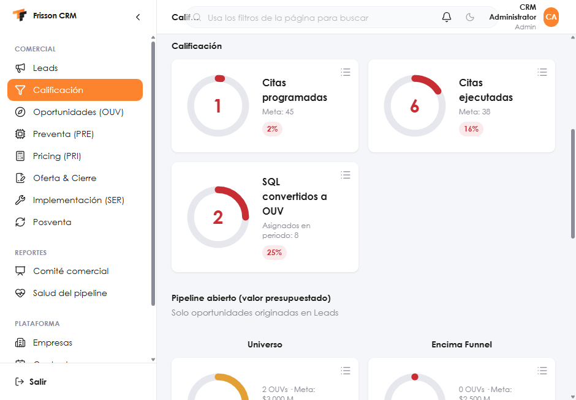
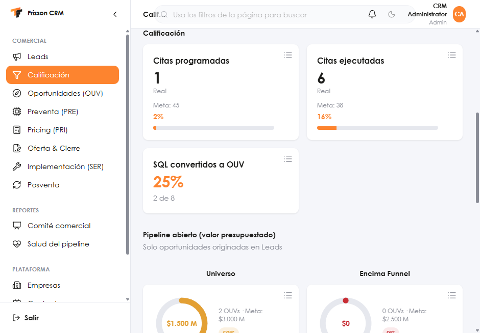
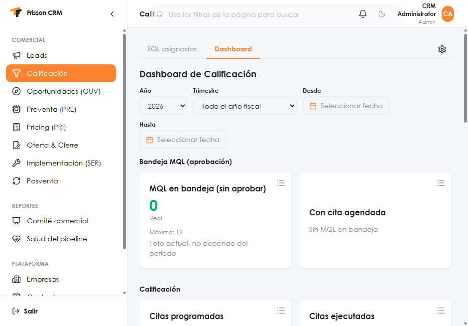
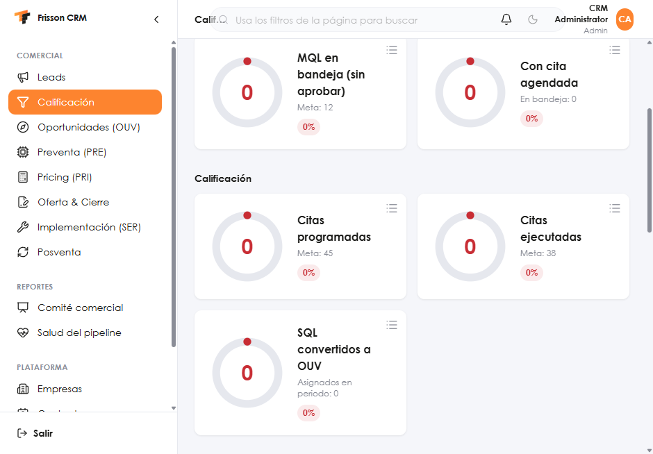
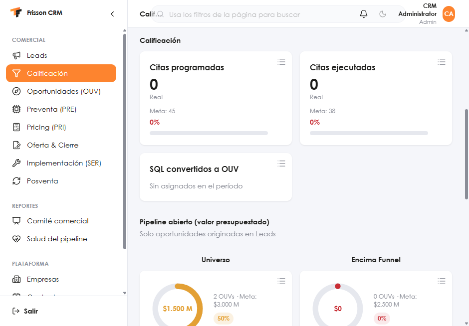
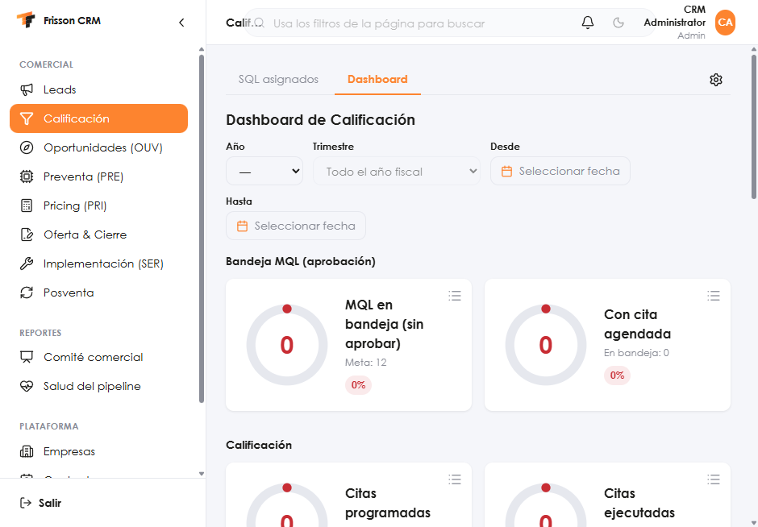
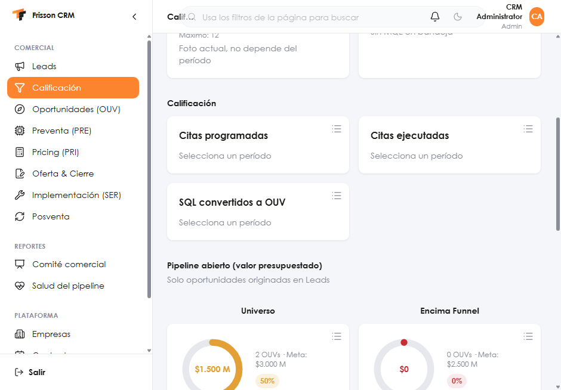

# RESUMEN-PASO-2 — KPIs de /qualification/dashboard

Fecha: 2026-10-29. Rama `EP-Feature-TableroCalificacion`, rebasada sobre `develop` en `dfbf043`. Solo frontend. Sin commit.

`bogota-fiscal.ts` ya estaba en `develop`. No se copió `bogotaFiscalYear`: la página lo importa desde `frontend/src/modules/demand-generation/lib/bogota-fiscal.ts`.

## Código

- `frontend/src/modules/qualification/lib/kpi-card.ts` — `kind`, `direction`, fase del período, porcentaje (`null` si el denominador es 0; el texto de ese null es «—»), ancho de barra con tope 100 %.
- `frontend/src/modules/qualification/components/KpiCard.tsx` — las cinco tarjetas.
- `QualificationDashboardCharts.tsx` — solo bandeja MQL y Calificación. `DonutMetric` y el pipeline siguen igual.
- `QualificationDashboardPage.tsx` — el año inicial es el año fiscal Verytel.

El frontend no tiene runner de pruebas. Los casos de la tabla se ejecutaron con `tsx` sobre las funciones puras (24 comprobaciones, todas en verde) y el script se borró para no dejarlo en el build. `npm run build` quedó en verde. ESLint de los archivos tocados quedó en verde.

## Pantalla, con la sesión de prueba

Hoy es 29 oct 2026. El año fiscal es 2026 y el selector «Año» arranca ahí. El 15 ene 2027, la misma función devuelve 2026; eso se comprobó en el script, no en el calendario del navegador.

Período en curso (año 2026). Antes, anillo rojo. Después, marca:

- Citas programadas: 1 de 45 → 2 %, barra naranja.
- Citas ejecutadas: 6 de 38 → 16 %, barra naranja.
- SQL → OUV: 25 % y «2 de 8», en naranja. El porcentaje sale de `sql_to_ouv_conversion_rate`.
- MQL en bandeja: 0, verde, «Máximo: 12» y «Foto actual, no depende del período».
- Con cita agendada: «Sin MQL en bandeja».

Período cerrado (año 2025). Los conteos del API son 0.

- Citas programadas y ejecutadas: 0 %, texto rojo, sin «Meta cumplida».
- SQL → OUV: «Sin asignados en el período».
- El anillo del pipeline (Universo, Encima Funnel) no cambió.

Sin período (año en «—»):

Las tres de Calificación dicen «Selecciona un período» y no muestran el 0. La bandeja MQL sigue en foto actual. El clic en «Citas programadas» abre el detalle «Citas programadas».

## Casos de las funciones puras

| Caso | Resultado |
| --- | --- |
| En curso, 1 / 10 | 10 %, tono accent, barra 10, sin «Meta cumplida» |
| En curso, 10 / 10 | 100 %, verde, «Meta cumplida», barra 100 |
| Cerrado, 5 / 10 | 50 %, rojo |
| Cerrado, 17 / 20 | 85 %, ámbar |
| Cerrado, 11 / 10 | 110 %, verde, barra 100, sin «Meta cumplida» |
| Denominador 0 | `null`, texto «—» |
| Snapshot 8 y 12 sobre máximo 12 | verde |
| Snapshot 15 sobre 12 | ámbar (125 % exacto) |
| Snapshot 16 sobre 12 | rojo |
| Tasa 3 / 10 y tasa API 0,25 | 30 % y 25 %, tono accent |
| Tasa null | `null` |
| 15 ene 2027 | año fiscal 2026 |
| Año 2026 el 29 oct 2026 | fase `open`, rango 2026-02-01 a 2027-01-31 |
| Año 2025 en esa fecha | fase `closed` |
| Sin año ni fechas | fase `none` |

Un rango que todavía no empieza usa los mismos tonos que el período en curso (sin rojo). «Meta cumplida» solo si hoy está dentro del rango.
